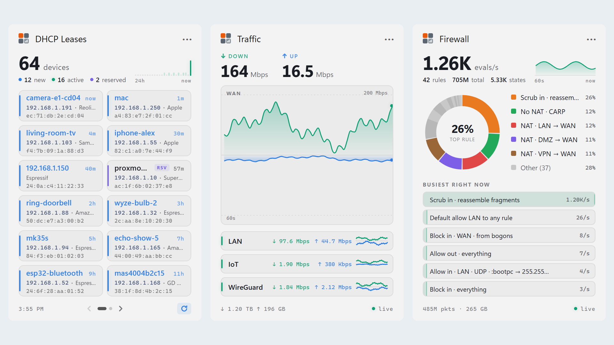

<div align="center">


# Widgets for OPNsense

**Your firewall, one keystroke away.**

DHCP leases, live traffic and firewall rules from your OPNsense router,<br>in the Windows 11 Widget Board, on the KDE Plasma 6 desktop and in the GNOME top bar.

<a href="https://apps.microsoft.com/detail/9PD1Z0HV5L04?mode=direct">
  <picture>
    <source media="(prefers-color-scheme: dark)" srcset="https://get.microsoft.com/images/en-us%20light.svg">
    
  </picture>
</a>

[](https://packages.alejandro.md) [](LICENSE) [](https://apps.microsoft.com/detail/9PD1Z0HV5L04) [](https://github.com/amd989/widgets-for-opnsense/wiki/Linux#kde-plasma-linux) [](https://github.com/amd989/widgets-for-opnsense/wiki/Linux#gnome-linux) [](https://dotnet.microsoft.com/)

[**Live demo**](https://amd989.github.io/widgets-for-opnsense/) · [Widgets](#widgets) · [Install](#install) · [Quick start](#quick-start) · [Wiki](https://github.com/amd989/widgets-for-opnsense/wiki) · [Troubleshooting](https://github.com/amd989/widgets-for-opnsense/wiki/Troubleshooting)

<br>

<picture>
  <source media="(prefers-color-scheme: dark)" srcset="design/logo/store/Screenshot-Dark.png">
  
</picture>

</div>

<br>

Keep an eye on an OPNsense router without opening its web UI: see who just joined your network, how busy the WAN is, and which firewall rules are doing the work. Press **Win+W** on Windows 11, glance at the Plasma desktop, or click the GNOME top bar button.

The Windows app is a native widget provider (C#, .NET 8, Windows App SDK) packaged as an MSIX. It talks to the OPNsense REST API and shows each widget as an HTML page served from the app itself. Hosts that can't show web content get Adaptive Cards instead, with charts drawn by SkiaSharp. On Linux a small user service does the same job for KDE Plasma 6 and GNOME Shell.

Free, MIT licensed, read only, no account and no telemetry. The widgets only talk to your own firewall.

> [OPNsense](https://opnsense.org)® is a registered trademark of Deciso B.V. This project is not affiliated with or endorsed by Deciso B.V. or the OPNsense project. The name is used with their permission.

## Install

| Platform | How |
|----------|-----|
| Windows 11 (x64, ARM64) | [Microsoft Store](https://apps.microsoft.com/detail/9PD1Z0HV5L04), or [build from source](https://github.com/amd989/widgets-for-opnsense/wiki/Building-from-Source) |
| Debian, Ubuntu, Fedora, EL9 (x86_64, arm64) | Packages for KDE Plasma 6 and GNOME 46+, see below |
| Other Linux | [Install from source](https://github.com/amd989/widgets-for-opnsense/wiki/Linux#kde-plasma-linux) with `linux/install.sh` |

On Linux, add the repository from [packages.alejandro.md](https://packages.alejandro.md) and install the package:

```bash
curl -fsSL https://packages.alejandro.md/setup.sh | sudo sh
```

```bash
sudo apt install opnsense-widgets
```

```bash
sudo dnf install opnsense-widgets
```

Log out and in again, then add the Plasma widgets or enable the GNOME extension in the Extensions app. More in the [Linux](https://github.com/amd989/widgets-for-opnsense/wiki/Linux) wiki page.

## Widgets

Every widget comes in small, medium and large sizes.

| Widget | Shows |
|--------|-------|
| **DHCP Leases** | Devices on your network, newest lease first, with new, active and reserved counts and a 24h activity sparkline. ISC DHCP and KEA DHCP are detected automatically. |
| **Traffic** | Live download and upload throughput per interface, with charts and WAN totals. |
| **Firewall** | The busiest firewall rules as a donut chart, using the rule descriptions you set in OPNsense. |

Details per size are in the [Widgets](https://github.com/amd989/widgets-for-opnsense/wiki/Widgets) wiki page.

## Quick start

1. In OPNsense, [create an API user](https://github.com/amd989/widgets-for-opnsense/wiki/OPNsense-API-User) with read access to what the widgets need, and download its API key.
2. Press **Win+W**, click **+** and add **DHCP Leases**, **Traffic** or **Firewall**.
3. Open the widget's **...** menu > **Customize**, enter the router URL, click **Import Key** to read the key file from Downloads, then **Test** and **Save**.

All widgets share one connection, so configuring one configures them all. On KDE Plasma a new widget shows **Set up** instead, and on GNOME you open **Settings…** from the top bar button.

## Documentation

The [wiki](https://github.com/amd989/widgets-for-opnsense/wiki) has the details:

- [Widgets](https://github.com/amd989/widgets-for-opnsense/wiki/Widgets): what each widget shows at each size
- [Setup](https://github.com/amd989/widgets-for-opnsense/wiki/Setup): connection settings, Import Key, where settings and keys are stored
- [Linux](https://github.com/amd989/widgets-for-opnsense/wiki/Linux): packages, KDE Plasma 6, GNOME Shell
- [OPNsense API User](https://github.com/amd989/widgets-for-opnsense/wiki/OPNsense-API-User): privileges each widget needs
- [Troubleshooting](https://github.com/amd989/widgets-for-opnsense/wiki/Troubleshooting): error messages, logs, resetting everything
- [Building from Source](https://github.com/amd989/widgets-for-opnsense/wiki/Building-from-Source) and [Development](https://github.com/amd989/widgets-for-opnsense/wiki/Development): build, add a widget, project structure, tech stack

## License

MIT. See [LICENSE](LICENSE).

[OPNsense](https://opnsense.org)® is a registered trademark of Deciso B.V. This project is not affiliated with or endorsed by Deciso B.V. or the OPNsense project. The name is used with their permission.

Privacy: see [PRIVACY.md](PRIVACY.md). The widgets only talk to your own firewall.
